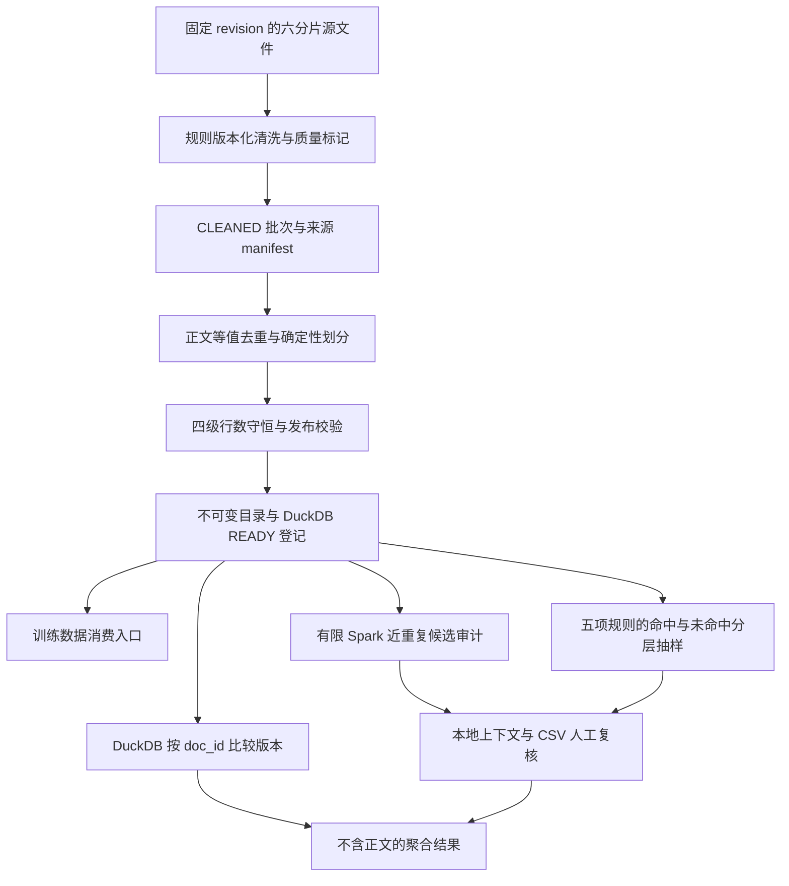

# 项目展示与面试演示

这个项目回答两个工程问题：怎样把公开中文快照稳定地加工为可追溯的训练数据版本，以及怎样检查已发布数据仍存在的质量风险。主流水线负责清洗、精确去重与发布；独立治理包负责版本差异、近重复候选和人工复核。公开仓库只展示代码、合成样例与聚合证据，正文与复核工作包保存在本地。

已核验的 v2 全量规模为 **1,384,748 条输入 → 5,570 条正文精确重复 → 1,379,178 篇保留文章**。规模、环境、日期与运行身份见 [实测记录](../VALIDATION.md)，处理成功不直接等于已经证明提升模型训练质量。

## 当前可展示的治理证据

| 能力 | 真实运行结果 | 证据 |
|---|---|---|
| 跨集合近重复审计 | 2,000 篇样本生成 16 对候选，其中 train/train 12 对、validation/validation 0 对、跨集合 4 对 | [审计汇总](../evidence/2026-11-02-governance/near-audit.json) |
| 近重复复核队列 | 16 对全部待人工复核，跨集合 4 对也全部待复核；人工确认比例为 `null` | [复核进度](../evidence/2026-11-02-governance/near-review.json) |
| 质量规则分层评审 | 5 规则 × 命中/未命中层，每层最多 20 条；共 175 条文章—规则任务、94 篇独立文章，全部待标注 | [样本清单摘要](../evidence/2026-11-02-governance/quality-sample.json) · [复核进度](../evidence/2026-11-02-governance/quality-review.json) |
| v1→v2 版本差异 | 两版全部 1,379,178 个 ID 对应；正文变化 1,364,883 篇、实际跨集合迁移 129,445 篇；validation 净增 959 篇 | [版本比较结果](../evidence/2026-11-02-governance/version-comparison.json) |
| 自动化验证 | 33 项治理聚焦测试、68 项当前完整测试通过 | [测试记录](../VALIDATION.md) |

长文本命中层仅有 14 篇、无字母内容命中层仅有 1 篇，所以实际评审任务为 175 条，不能写成理论上限 200 条。队列生成与未标注汇总已在真实版本上运行；人工标签导入和统计由合成测试验证，真实人工评估尚未完成。

## 架构与职责



`corpus_pipeline` 维护处理与发布合同，`corpus_governance` 读取已经 READY 的版本并写独立审计目录。治理模块不修改原包源码，所以原流水线的实现指纹保持不变；既有发布不需要为新增比较或复核工具重新清洗。版本比较与分层抽样使用 DuckDB，近重复候选生成继续使用 Spark ML。

此边界已通过 [发布完整性复核](../evidence/2026-11-02-governance/release-integrity.json)：核心实现指纹保持一致，两个历史 READY 版本可读。治理工具使用 `main`；历史 `v0.2.0` 与 `baseline-v1` 标签保持原指向。

文件 rename 与 DuckDB 登记并非一个跨系统事务。消费者只发现 READY 清单；故障恢复核对同一 manifest 身份，避免把未登记目录或 Spark `_SUCCESS` 误当作业务成功。

## 改进前后

| 关注点 | 既有实现 | 当前实现 |
|---|---|---|
| 文本规范化 | v1 的 NFC、换行和空白规范化 | v2 增加有限全角 ASCII 转换、控制字符清理，保留符号、繁简差异和缩进 |
| 质量提示 | 篇幅与重复行标记 | 增加中文占比、无字母内容及控制字符处理标记；不凭标记自动删文 |
| 近重复解释 | 有限候选总数与本地文本对 | 独立治理审计区分 train/train、validation/validation 与跨集合候选，关联 audit identity 和稳定 pair ID |
| 人工判断 | 待复核候选清单 | CSV 记录标签、实际复核人、日期及备注；核对队列身份，区分待处理、明确结论与不能确定 |
| 质量规则评估 | 汇总命中数量 | 每条风险规则分别抽取命中与未命中层，按文章—规则独立评审 |
| 版本差异 | 比较两个发布报告的总量 | 按共同 `doc_id` 比较正文和实际 split 迁移，另外统计代表文章集合增减 |

## 建议演示顺序

1. **先看数据合同。** 展示 [README](../README.md) 的固定来源、清洗规则、精确去重定义和 READY 发布流程。解释为什么规则标记保留文章、源 ID 冲突阻止发布，而相同正文使用确定性代表 ID。
2. **运行可重复的小样例。** 展示 9 条合成输入的质量守恒和 READY 产物，重复执行后仍为同一发布；这是功能样例，不代表真实语料规模。
3. **核对真实发布证据。** 打开 [v2 聚合报告](../evidence/2026-11-02/release-v2.json) 与 [Airflow 运行记录](../evidence/2026-11-02/airflow-success.json)，关联源 revision、六片来源摘要、规则版本、发布 ID 和任务状态。
4. **解释版本迁移。** 使用 [版本比较入口与真实实例](COMPARISON.md)，展示 train→validation 的 65,202 篇和反向的 64,243 篇：实际迁移合计 129,445 篇，净增却只有 959 篇。正文差异说明规则产生影响，不能当成质量改善证明。
5. **展示可完成的复核流程。** 按 [治理操作说明](GOVERNANCE.md) 查看本地上下文、填写 CSV 再汇总。没有人工结论时保留 pending 与 `null`，展示工具能力和当前完成边界。

### 离线合成演示

PowerShell 7，在项目根目录执行。构建镜像需要网络；下列演示不下载 Wikipedia，也不启动 Airflow 服务。

```powershell
docker compose build cli
docker compose run --rm --no-deps cli run-demo
docker compose run --rm --no-deps cli inspect --release-id synthetic-cli-v2
```

### 已有真实发布时的版本比较

该命令要求数据卷中同时存在两版 READY 数据；公开仓库本身不附带正文或数据库。

```powershell
docker compose run --rm --no-deps --entrypoint python cli -m corpus_governance --root /opt/airflow/data compare-releases --left-release-id wiki-full-20260909 --right-release-id wiki-full-v2-20261102
```

人工复核无需在面试中完成全部标注。可选一个本地合成样例解释填写方式；真实样本的任何标签必须来自实际复核，不能用演示标签替代。

## 展示结果时的统计边界

- **候选与已确认问题分开。** 跨 train/validation 的近重复候选只是风险线索，未经人工核验不能写作已证实数据泄漏；候选生成也没有测量全语料召回率。
- **进度与质量比例分开。** `reviewed_count` 包括 `uncertain`，比例的分母只包含明确正反判断；没有明确判断时为 `null`。当前人工标签尚待填写，不能展示人工准确率。
- **文章与评审行分开。** 同一篇文章可以在多个规则下评审，队列行数不等于独立文章数；某层不足上限时按实际样本量报告。
- **分层比例不外推全库。** 每条规则的命中／未命中层有固定抽样上限，分别报告 `issue / (issue + acceptable)`；总体不计算混合问题比例，也不把分层结果当作全库准确率或训练收益。
- **变化口径说明对象。** 版本增减指发布代表文章集合变化，不代表源文章修订或删除史；共同 ID 的正文变化与 train↔validation 迁移均按实际匹配记录计数。缺失的旧版质量指标为 `null`，不是零。
- **历史与当前运行分开。** v1 与 v2 的去重总数恰好相同不能说明正文没变；实测任务时长是具体运行观测，不直接用来宣称规则优化带来性能提升。

## 简历描述参考

- 基于 PySpark、Airflow 与 DuckDB 构建中文语料清洗、跨批次精确去重及不可变发布流水线，处理六分片 138.47 万篇输入，移除 5,570 条重复正文，发布 137.92 万篇可追溯语料。
- 实现有限全半角转换、控制字符清理与篇幅／中文占比审计标记，通过质量守恒、确定性划分和 READY 事务登记保障幂等发布及中断恢复；包含治理扩展的 68 项自动化测试通过。
- 独立实现版本比较与人工复核工具，在 2,000 篇样本中生成 16 对近重复候选（含 4 对跨集合候选），按五项规则生成覆盖 94 篇文章的 175 条分层评审任务，保留明确的待人工标注状态。

上述第三条描述工具已实现的能力，不宣称人工标签已经完成，也不把待复核候选或分层抽样结果写作全库质量提升。
